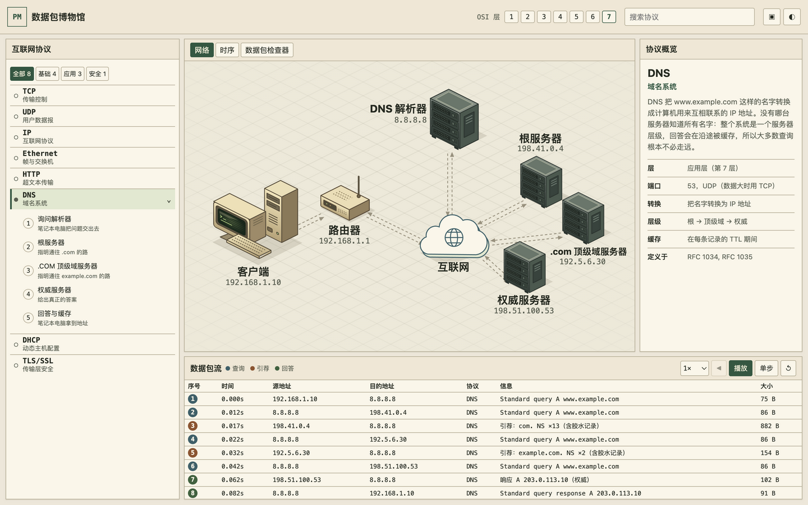

# 互联网协议

把互联网协议做成可以一步步播放的交互演示：看数据包怎样在电脑、交换机、路由器和服务器之间流动，并逐字节拆开每一帧报文。

在线访问：<https://loseheart-dev.github.io/packet-museum/>



## 课程

| 层 | 课程 | 演示内容 |
|---|---|---|
| 链路层 | 以太网 / ARP | ARP 广播与应答、交换机 MAC 学习与转发、最小帧填充 |
| 网络层 | IP | 逐跳转发、TTL 递减与校验和重算、NAT |
| 传输层 | TCP | 三次握手、数据与确认、丢包与 SACK 重传、四次挥手 |
| 传输层 | UDP | 无连接数据报、并发数据流、丢包 |
| 应用层 | DNS | 递归解析、根/顶级域/权威服务器查询、缓存 |
| 应用层 | HTTP | DNS 与 TCP 建连、请求与分段响应、页面渲染 |
| 应用层 | TLS 1.3 | Client Hello、Server Hello、证书、Finished、加密数据、关闭 |
| 应用层 | DHCP | Discover / Offer / Request / ACK 与续租 |

## 功能

- **网络视图**：复古机房风格的拓扑场景，数据包沿链路飞行，镜头随步骤推近拉远。
- **时序视图**：泳道式时序图，与网络视图随时切换。
- **分步播放**：播放 / 暂停 / 上一步 / 下一步，可调速度；右栏在知识讲解与当前步骤详情之间切换。
- **数据包流**：底部表格列出每一帧，点击即可查看。
- **报文检查器**：按协议层逐字段展开，并在十六进制字节中高亮对应位置。

报文全部由代码按协议规范构造，以太网、IPv4、UDP、TCP 校验和与各层长度字段由自动测试校验。

键盘：`←` / `→` 切换步骤，`空格` 播放或暂停，`Esc` 关闭时序视图中打开的报文检查器。

## 本地运行

直接用浏览器打开根目录的 `index.html` 即可查看；修改源码后运行 `npm run build:standalone` 更新它。

需要 Node.js 20 及以上。

```bash
npm install
npm run dev      # 开发服务器
npm test         # 运行测试
npm run build    # 构建到 dist/
```

推送到 `main` 后由 GitHub Actions 自动测试、构建并发布到 GitHub Pages。

## 项目结构

```
src/
  lessons/<课程>/   每门课一个目录：场景、步骤、报文、文案
  lib/bytes/        各协议报文的构造与逐字段解析
  ui/               场景、镜头、时序图、数据包流、检查器
  art/              复古设备图形
  playback.js       播放控制
test/               报文校验与课程数据测试
docs/               实施方案、课程编写说明、截图
design/             早期样稿
```

新增一门课只需在 `src/lessons/` 下新建目录，课程会被自动注册和测试，写法见 [docs/lesson-authoring.md](docs/lesson-authoring.md)。

## 技术栈

Vite + 原生 JavaScript（ES Modules）+ SVG，无运行时依赖。
